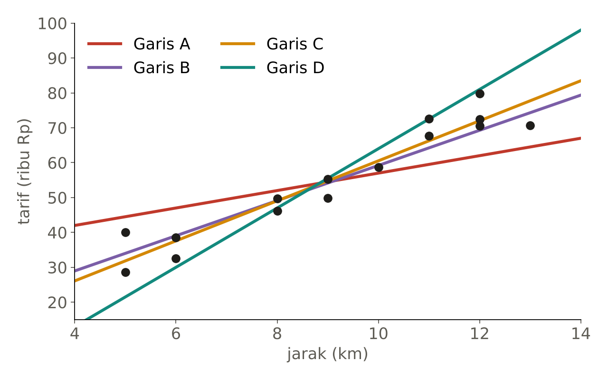
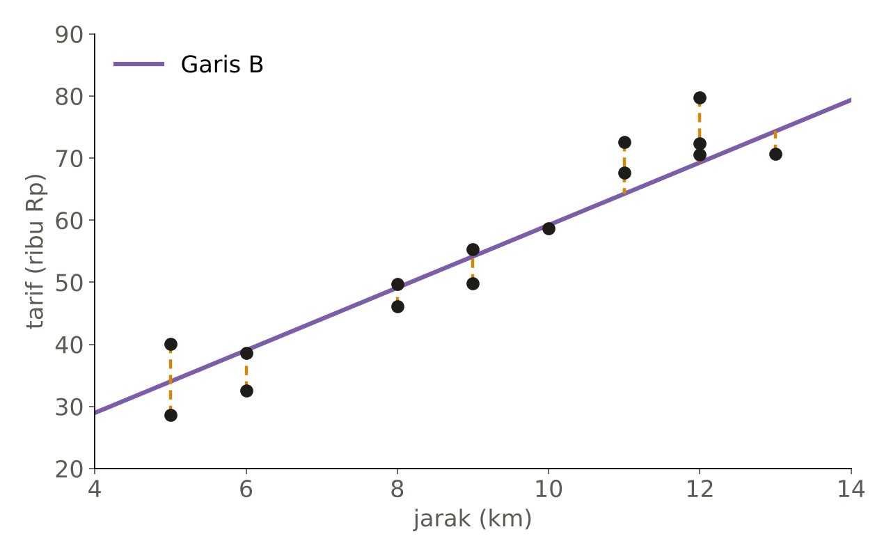
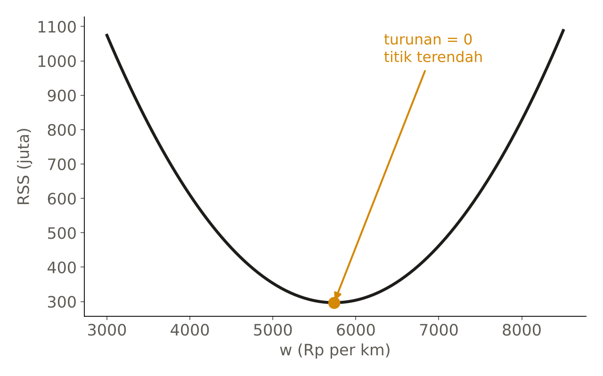

# Komputer Tidak Bisa Melihat Garis. Jadi Kami Mengajarinya Menghitung.

Pertemuan 1 Advance Study Group track AI, ML, dan Optimasi membahas satu topik: **regresi linear**. Hampir semua kelas machine learning memulai dari topik ini, dan biasanya rumusnya langsung diberikan. Kami memilih jalan yang lebih panjang: rumus least squares kami turunkan bersama di kelas, langkah demi langkah, dari pertanyaan yang paling sederhana. Tulisan ini merangkum alurnya.

## Masalahnya: berapa tarif Go-car bulan depan?

Bayangkan sebuah perusahaan travel, JalanJalan, yang sering memakai Go-car untuk mengantar tamu. Mereka harus menyusun anggaran bulanan, jadi tarif perlu diperkirakan jauh hari sebelumnya. Yang mereka punya hanya catatan 15 perjalanan sebelumnya: jarak dan tarif yang dibayar.

| km | 5 | 5 | 6 | 6 | 8 | 8 | 9 | 9 | 10 | 11 | 11 | 12 | 12 | 12 | 13 |
|---|---|---|---|---|---|---|---|---|---|---|---|---|---|---|---|
| Tarif (ribu Rp) | 28,6 | 40,1 | 32,6 | 38,6 | 49,7 | 46,1 | 55,3 | 49,8 | 58,7 | 67,7 | 72,6 | 79,8 | 72,4 | 70,6 | 70,7 |

Contoh Go-car ini berasal dari Dr. Didit Adytia, S.Si., M.Si., dari mata kuliah Machine Learning di Informatika Telkom University.

Kalau digambar, polanya jelas: makin jauh, makin mahal, dan titik-titiknya hampir membentuk garis lurus. Maka modelnya sebuah garis:

> **f(x) = w·x + a**, dengan **w** kemiringan (tambahan tarif per km) dan **a** titik potong.

Setiap pilihan w dan a menghasilkan garis yang berbeda. Pertanyaannya: garis mana yang terbaik?

## Garis mana yang paling cocok?

Kami menggambar empat garis di atas data dan meminta semua orang memilih dengan angkat tangan.



Garis A dan D cepat ditolak: yang satu terlalu landai, yang lain terlalu curam. Garis B dan C membuat kelas terbelah, karena keduanya hampir sama di mata kita. Alasan yang muncul kira-kira "yang ini kelihatannya lebih pas".

Di sinilah inti pertemuan ini. Kita manusia bisa merasakan garis mana yang pas. **Komputer tidak bisa melihat gambar sama sekali.** Ia hanya bisa menghitung. Kalau kita ingin komputer yang memilih garis, kita harus mendefinisikan dengan tepat, dalam bentuk angka, seberapa tidak cocok sebuah garis dengan data.

## Dari error ke RSS

Mulai dari satu perjalanan. Selisih antara tarif sebenarnya dan prediksi garis disebut **error** atau residual:

> **eᵢ = yᵢ − ŷᵢ**



Error bisa positif (data di atas garis) atau negatif (di bawah). Kalau dijumlahkan begitu saja, keduanya saling menghapus, dan garis yang jelek pun bisa tampak sempurna. Solusinya: kuadratkan setiap error, baru dijumlahkan. Hasilnya adalah **Residual Sum of Squares (RSS)**, di materi kuliah disebut juga SSE:

> **RSS(w, a) = Σ (yᵢ − w·xᵢ − a)²**

Satu garis menghasilkan satu angka, dan sekarang komputer bisa membandingkan:

| Garis | RSS (juta) |
|---|---|
| A | 1.392,1 |
| B | 355,2 |
| C | 296,9 |
| D | 1.105,9 |

Garis C menang, walaupun di mata kita B dan C hampir tidak bisa dibedakan. Lalu muncul pertanyaan berikutnya: garis yang mungkin ada tak terhingga banyaknya. Apakah C yang terbaik dari semuanya?

## Menjadi masalah optimasi

Pertanyaan itu adalah masalah optimasi pertama di kelas ini:

- **Variabel keputusan:** w dan a
- **Fungsi tujuan:** RSS(w, a)
- **Batasan:** tidak ada

Cari w dan a yang membuat RSS sekecil mungkin. Untuk garis lurus, kalkulus memberi jawabannya secara pasti: di titik terendah sebuah fungsi, turunannya nol.

## Menurunkan rumusnya, langkah demi langkah

Bagian ini yang membuat pertemuan kami berbeda. Rumusnya tidak kami tempel di slide. Kami menurunkannya bersama di papan tulis, satu baris aljabar per langkah, dan peserta ikut mengerjakan salah satu turunannya secara berpasangan. Berikut derivasi lengkapnya, persis seperti di papan. Semua Σ berarti jumlah dari i = 1 sampai n, dan x̄, ȳ adalah rata-rata x dan y.

### Titik awal

| Persamaan | Alasan |
|---|---|
| ŷᵢ = w·xᵢ + a | model garis |
| eᵢ = yᵢ − ŷᵢ | error (residual) setiap data |
| RSS(w, a) = Σ eᵢ² = Σ (yᵢ − ŷᵢ)² = Σ (yᵢ − w·xᵢ − a)² | jumlah kuadrat error, ditulis dalam w dan a |

Di titik terendah, kedua turunan parsial bernilai nol. Jadi kita turunkan RSS terhadap w dan terhadap a, lalu samakan dengan nol.

### Langkah 1: turunan terhadap w

| Persamaan | Alasan |
|---|---|
| ∂RSS/∂w = Σ 2(yᵢ − w·xᵢ − a)·(−xᵢ) | aturan rantai: turunan u² adalah 2u·u′, dan turunan (yᵢ − w·xᵢ − a) terhadap w adalah −xᵢ |
| = −2 Σ (xᵢyᵢ − w·xᵢ² − a·xᵢ) = 0 | kalikan −xᵢ ke dalam kurung, lalu samakan dengan nol |
| Σ (xᵢyᵢ − w·xᵢ² − a·xᵢ) = 0 | bagi kedua ruas dengan −2 |
| Σ xᵢyᵢ − Σ w·xᵢ² − Σ a·xᵢ = 0 | pecah jumlahnya |
| Σ xᵢyᵢ − w Σ xᵢ² − a Σ xᵢ = 0 | w dan a tidak bergantung pada i, jadi keluar dari Σ |
| **Σ xᵢyᵢ = w Σ xᵢ² + a Σ xᵢ** | pindahkan ruas; simpan sebagai persamaan (I) |

### Langkah 2: turunan terhadap a

Langkah ini dikerjakan peserta sendiri selama tiga menit sebelum kami bahas.

| Persamaan | Alasan |
|---|---|
| ∂RSS/∂a = Σ 2(yᵢ − w·xᵢ − a)·(−1) | aturan rantai; turunan (yᵢ − w·xᵢ − a) terhadap a adalah −1 |
| = −2 Σ (yᵢ − w·xᵢ − a) = 0 | keluarkan −2, samakan dengan nol |
| Σ (yᵢ − w·xᵢ − a) = 0 | bagi dengan −2 |
| Σ yᵢ − Σ w·xᵢ − Σ a = 0 | pecah jumlahnya |
| Σ yᵢ − w Σ xᵢ − a·n = 0 | a dijumlah sebanyak n kali, jadi Σa = a·n |
| Σ yᵢ = w Σ xᵢ + a·n | pindahkan ruas |
| (1/n) Σ yᵢ = (1/n) w Σ xᵢ + a | bagi kedua ruas dengan n |
| a = (1/n) Σ yᵢ − w (1/n) Σ xᵢ | pindahkan ruas |
| **â = ȳ − w·x̄** | (1/n) Σ yᵢ = ȳ dan (1/n) Σ xᵢ = x̄ |

Artinya garis terbaik selalu melewati titik (x̄, ȳ), pusat data.

### Langkah 3: masukkan â ke persamaan (I)

| Persamaan | Alasan |
|---|---|
| w Σ xᵢ² + a Σ xᵢ = Σ xᵢyᵢ | persamaan (I) |
| w Σ xᵢ² + (ȳ − w·x̄) Σ xᵢ = Σ xᵢyᵢ | ganti a dengan ȳ − w·x̄ |
| w Σ xᵢ² + ȳ Σ xᵢ − w·x̄ Σ xᵢ = Σ xᵢyᵢ | buka kurung |
| w Σ xᵢ² − w·x̄ Σ xᵢ = Σ xᵢyᵢ − ȳ Σ xᵢ | suku tanpa w pindah ke kanan |
| w (Σ xᵢ² − x̄ Σ xᵢ) = Σ xᵢyᵢ − ȳ Σ xᵢ | keluarkan w |
| **ŵ = (Σ xᵢyᵢ − ȳ Σ xᵢ) / (Σ xᵢ² − x̄ Σ xᵢ)** | bagi kedua ruas |

Rumus ini sudah benar, tetapi bisa ditulis lebih rapi. Pembilang dan penyebutnya kita olah satu per satu, memakai satu fakta: Σ xᵢ = n·x̄ dan Σ yᵢ = n·ȳ.

### Langkah 4: merapikan pembilang

| Persamaan | Alasan |
|---|---|
| Σ xᵢyᵢ − ȳ Σ xᵢ | pembilang dari langkah 3 |
| = Σ xᵢyᵢ − n·x̄·ȳ | Σ xᵢ = n·x̄ |
| = Σ xᵢyᵢ − n·x̄·ȳ − n·x̄·ȳ + n·x̄·ȳ | tambah lalu kurangi n·x̄·ȳ (nilainya tidak berubah) |
| = Σ xᵢyᵢ − ȳ Σ xᵢ − x̄ Σ yᵢ + Σ x̄·ȳ | n·x̄·ȳ ditulis ulang sebagai ȳ Σ xᵢ, x̄ Σ yᵢ, dan Σ x̄·ȳ |
| = Σ (xᵢyᵢ − xᵢ·ȳ − x̄·yᵢ + x̄·ȳ) | gabungkan menjadi satu jumlah |
| **= Σ (xᵢ − x̄)(yᵢ − ȳ)** | faktorkan |

### Langkah 5: merapikan penyebut

| Persamaan | Alasan |
|---|---|
| Σ xᵢ² − x̄ Σ xᵢ | penyebut dari langkah 3 |
| = Σ xᵢ² − n·x̄² | Σ xᵢ = n·x̄ |
| = Σ xᵢ² − 2n·x̄² + n·x̄² | tulis −n·x̄² sebagai −2n·x̄² + n·x̄² |
| = Σ xᵢ² − 2x̄ Σ xᵢ + Σ x̄² | 2n·x̄² = 2x̄ Σ xᵢ, dan n·x̄² = Σ x̄² |
| = Σ (xᵢ² − 2x̄·xᵢ + x̄²) | gabungkan menjadi satu jumlah |
| **= Σ (xᵢ − x̄)²** | bentuk kuadrat sempurna |

### Hasil akhir

> **ŵ = Σ (xᵢ − x̄)(yᵢ − ȳ) / Σ (xᵢ − x̄)²**
>
> **â = ȳ − ŵ·x̄**

Jika pembilang dan penyebut ŵ sama-sama dibagi n − 1, keduanya menjadi kovarians x dan y serta varians x. Jadi ŵ juga bisa dibaca sebagai cov(X, Y) / var(X).

Ingin membaca bukti yang sama dalam bentuk formal? Lihat [Ordinary least squares for simple linear regression](https://statproofbook.github.io/P/slr-ols.html) di The Book of Statistical Proofs (Joram Soch), yang menjadi salah satu inspirasi alur derivasi kami.

Untuk data Go-car hasilnya ŵ ≈ 5.737,7 dan â ≈ 3.148,8: setiap tambahan 1 km, tarif naik sekitar Rp5.738. Dan ternyata **garis C dari voting tadi adalah garis ini**. Tidak ada garis lain dengan RSS lebih kecil pada data tersebut.

Mengapa turunan nol pasti titik terendah? Karena RSS adalah jumlah kuadrat, bentuknya mangkuk dengan satu dasar.



## Mengapa repot menurunkannya?

Ada dua alasan. Pertama, rumus yang diturunkan sendiri lebih mudah diingat dan lebih sulit disalahgunakan: peserta tahu dari mana setiap simbol berasal. Kedua, derivasi ini memperlihatkan batasnya. Rumus pasti seperti ini hanya ada karena modelnya garis lurus dan error-nya dikuadratkan. Jaringan saraf, atau "otak" komodo di game Flappy Komodo dari Pertemuan 0, tidak punya rumus seperti ini. Dari situlah kebutuhan akan gradient descent dan metaheuristik muncul di pertemuan-pertemuan berikutnya.

## Latihan: jam berapa HP-mu mati?

Setelah derivasi, peserta memakai rumusnya sendiri pada data yang hubungannya negatif: baterai HP (%) selama bermain game, dicatat setiap 10 menit. Datanya kami susun khusus untuk latihan.

| Menit | 0 | 10 | 20 | 30 | 40 |
|---|---|---|---|---|---|
| Baterai (%) | 97 | 89 | 80 | 74 | 66 |

Dengan kalkulator: x̄ = 20, ȳ = 81,2, ŵ = −0,77, dan â = 96,6. Baterai turun sekitar 0,77% per menit. RSS garis ini 1,90, lebih kecil dari garis yang ditarik lewat titik pertama dan terakhir (2,375). Prediksi setelah 60 menit 50,4%, dan baterai habis setelah sekitar 125 menit.

Pertanyaan terakhirnya yang paling ramai: berapa prediksi setelah 180 menit? Jawabannya **−42%**. Baterai tentu tidak bisa negatif. Data kita hanya mencakup 0 sampai 40 menit, dan garisnya diperpanjang jauh di luar rentang itu. Ini contoh ekstrapolasi, dan pelajaran bahwa model hanya bisa dipercaya di dalam wilayah datanya.

## Live coding

Kami menutup dengan menulis rumus yang sama dalam Python bersama-sama. Dengan NumPy, kodenya hampir identik dengan rumus di papan:

```python
import numpy as np

x = np.array([0, 10, 20, 30, 40])     # menit bermain
y = np.array([97, 89, 80, 74, 66])    # baterai (%)

x_bar, y_bar = x.mean(), y.mean()
w = np.sum((x - x_bar) * (y - y_bar)) / np.sum((x - x_bar) ** 2)
a = y_bar - w * x_bar

def rss(x, y, w, a):
    return np.sum((y - (w * x + a)) ** 2)

print(w, a, rss(x, y, w, a))       # -0.77  96.6  1.9
print(w * 180 + a)                 # -42.0
```

`x - x_bar` mengurangi rata-rata dari semua angka sekaligus, dan `np.sum` adalah Σ. Hasilnya sama persis dengan hitungan tangan.

## Pekan depan

Pertemuan ini selesai dengan rumus karena masalahnya istimewa: garis lurus dan error kuadrat. Pertemuan 2 membahas apa yang dilakukan ketika rumus seperti itu tidak ada. Kita akan memakai turunan yang sama hari ini sebagai arah untuk berjalan menuruni mangkuk, sedikit demi sedikit: **gradient descent**. Bacaannya UDL (Understanding Deep Learning, Simon J. D. Prince) bagian 6.1 sampai 6.2.
