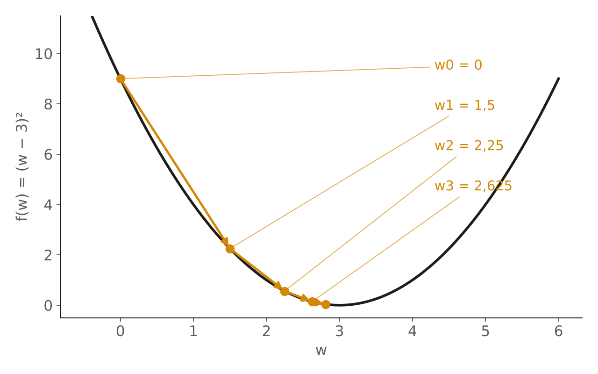
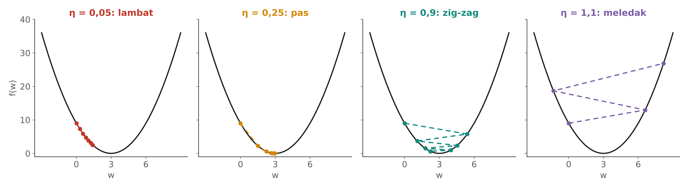
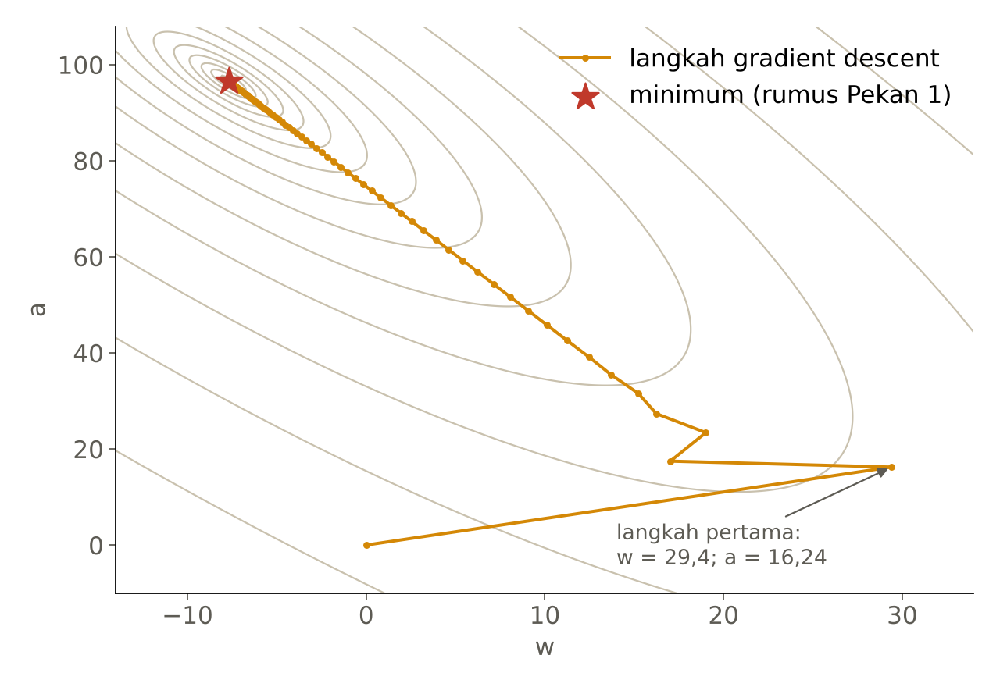
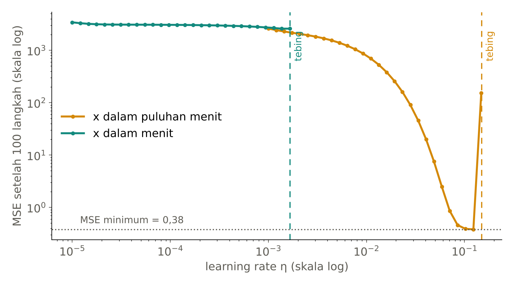

# Kalau Rumusnya Tidak Ada, Ikuti Kemiringannya

Di Pertemuan 1 kami menurunkan rumus least squares di papan tulis: samakan turunan RSS dengan nol, selesaikan, dan garis terbaik keluar dalam satu langkah. Pertemuan 2 dimulai dari pertanyaan berikutnya: **bagaimana kalau rumus seperti itu tidak ada?**

Untuk garis lurus dengan error kuadrat, persamaan "turunan = 0" bisa diselesaikan dengan aljabar. Untuk hampir semua model lain, termasuk jaringan saraf, persamaan itu tidak bisa diselesaikan. Tetapi turunannya masih bisa kita hitung di titik mana pun. Itu saja yang dibutuhkan **gradient descent**.

## Turun gunung dalam kabut

Bayangkan turun gunung dalam kabut tebal. Kita tidak melihat dasar lembah. Yang bisa kita rasakan hanya kemiringan tanah di bawah kaki. Jadi kita melangkah sedikit ke arah turun, merasakan lagi, lalu melangkah lagi, sampai tanahnya datar.

Kemiringan itu adalah turunan:

- Kalau f′(w) negatif, tanah turun ke kanan, jadi kita melangkah ke kanan.
- Kalau f′(w) positif, tanah turun ke kiri, jadi kita melangkah ke kiri.
- Kalau f′(w) nol, kita sudah di dasar.

Selalu melangkah berlawanan dengan tanda turunan. Ditulis sebagai rumus:

> **w_baru = w − η · f′(w)**

Tanda minus membuat kita melangkah berlawanan arah kemiringan. **η** (eta), atau *learning rate*, adalah ukuran langkah, angka yang kita pilih sendiri. Dan karena f′(w) mengecil di dekat dasar, langkahnya ikut memendek dengan sendirinya.

## Hitung tangan: empat langkah

Kami mulai dari lembah paling sederhana, f(w) = (w − 3)², yang turunannya f′(w) = 2(w − 3). Mulai dari w = 0 dengan η = 0,25:

| Langkah | w | f′(w) = 2(w − 3) | w baru = w − 0,25 · f′(w) |
|---|---|---|---|
| 0 | 0 | −6 | 1,5 |
| 1 | 1,5 | −3 | 2,25 |
| 2 | 2,25 | −1,5 | 2,625 |
| 3 | 2,625 | −0,75 | 2,8125 |

Jarak ke dasar (w = 3) menjadi setengahnya di setiap langkah: 3; 1,5; 0,75; 0,375.



## Tebak dulu: apa yang terjadi kalau η berubah?

Sebelum melihat jawabannya, setiap pasangan menghitung tiga langkah untuk satu nilai η lalu menebak: lambat, pas, zig-zag, atau meledak?

| η | w₁ | w₂ | w₃ | Yang terjadi |
|---|---|---|---|---|
| 0,05 | 0,3 | 0,57 | 0,813 | lambat |
| 0,25 | 1,5 | 2,25 | 2,625 | pas |
| 0,9 | 5,4 | 1,08 | 4,536 | melompati dasar bolak-balik, tetap mendekat (zig-zag) |
| 1,1 | 6,6 | −1,32 | 8,184 | melompat makin jauh (meledak) |



Mengapa 0,9 masih sampai sedangkan 1,1 meledak, padahal angkanya berdekatan? Satu baris aljabar menjelaskan semuanya. Untuk lembah f(w) = c(w − m)² dengan turunan f′(w) = 2c(w − m):

| Persamaan | Alasan |
|---|---|
| w_baru = w − η · 2c(w − m) | aturan update |
| w_baru − m = (w − m) − 2ηc(w − m) | kurangi kedua ruas dengan m |
| **w_baru − m = (1 − 2ηc)(w − m)** | keluarkan (w − m) |

Jarak ke dasar dikalikan faktor yang sama, (1 − 2ηc), di setiap langkah:

| η × 2c | Faktor (1 − 2ηc) | Yang terjadi |
|---|---|---|
| kurang dari 1 | antara 0 dan 1 | mendekat dari satu sisi, makin pelan |
| tepat 1 | 0 | sampai di dasar dalam satu langkah |
| antara 1 dan 2 | antara −1 dan 0 | zig-zag, tetap mendekat |
| 2 atau lebih | −1 atau kurang | melompat makin jauh: meledak |

Untuk (w − 3)², c = 1. Jadi η = 0,9 memberi faktor −0,8 (zig-zag yang menyusut), sedangkan η = 1,1 memberi −1,2 (zig-zag yang membesar). Lembah yang lebih curam (c lebih besar) membutuhkan η yang lebih kecil.

## Dua parameter: menurunkan gradien MSE

Lalu kami kembali ke data baterai dari Pertemuan 1, dengan model ŷᵢ = w·xᵢ + a dan error eᵢ = yᵢ − ŷᵢ. Untuk gradient descent kami memakai **MSE**, rata-rata kuadrat error:

> **MSE(w, a) = (1/n) Σ (yᵢ − w·xᵢ − a)² = RSS / n**

Garis terbaiknya sama dengan RSS, karena membagi dengan n tidak menggeser titik terendah. Bedanya, dengan RSS gradien ikut membesar kalau datanya bertambah, sehingga η yang pas ikut berubah. Dengan MSE tidak.

Turunannya kami turunkan bersama, persis seperti di papan Pertemuan 1, hanya dengan tambahan 1/n. Semua Σ berarti jumlah dari i = 1 sampai n.

**Turunan terhadap w**

| Persamaan | Alasan |
|---|---|
| ∂MSE/∂w = (1/n) Σ ∂/∂w (yᵢ − w·xᵢ − a)² | 1/n keluar; turunan dari jumlah adalah jumlah dari turunan |
| = (1/n) Σ 2(yᵢ − w·xᵢ − a) · (−xᵢ) | aturan rantai: turunan bagian dalamnya terhadap w adalah −xᵢ |
| = −(2/n) Σ xᵢ (yᵢ − w·xᵢ − a) | keluarkan konstanta −2 |
| **= −(2/n) Σ xᵢ eᵢ** | karena eᵢ = yᵢ − w·xᵢ − a |

**Turunan terhadap a**

| Persamaan | Alasan |
|---|---|
| ∂MSE/∂a = (1/n) Σ ∂/∂a (yᵢ − w·xᵢ − a)² | langkah yang sama |
| = (1/n) Σ 2(yᵢ − w·xᵢ − a) · (−1) | turunan bagian dalamnya terhadap a adalah −1 |
| = −(2/n) Σ (yᵢ − w·xᵢ − a) | keluarkan konstanta −2 |
| **= −(2/n) Σ eᵢ** | dengan eᵢ yang sama |

Satu kalimat menjadi inti pertemuan ini: **pekan lalu turunan ini disamakan dengan nol lalu diselesaikan; hari ini turunan yang sama dihitung di posisi kita sekarang dan dipakai sebagai arah langkah.**

Kedua parameter diperbarui sekaligus, memakai gradien yang dihitung dari w dan a yang lama:

> **w ← w − η · ∂MSE/∂w**
> **a ← a − η · ∂MSE/∂a**

## Satu langkah pada data baterai

Datanya sama dengan Pertemuan 1, dengan x ditulis dalam puluhan menit supaya angkanya kecil. Mulai dari w = 0, a = 0, η = 0,1:

| x (puluhan menit) | 0 | 1 | 2 | 3 | 4 | Jumlah |
|---|---|---|---|---|---|---|
| y (baterai %) | 97 | 89 | 80 | 74 | 66 | |
| e = y − (0·x + 0) | 97 | 89 | 80 | 74 | 66 | 406 |
| x · e | 0 | 89 | 160 | 222 | 264 | 735 |

∂MSE/∂w = −(2/5) · 735 = −294, sehingga w = 0 − 0,1 · (−294) = **29,4**.
∂MSE/∂a = −(2/5) · 406 = −162,4, sehingga a = 0 − 0,1 · (−162,4) = **16,24**.

Lho, w naik ke 29,4, padahal jawabannya negatif? Garis awal berada di ketinggian 0 dan semua titik jauh di atasnya, jadi memiringkan garis ke atas adalah cara tercepat untuk mengangkatnya. Beberapa langkah kemudian a sudah menyusul, dan w berbalik arah. Gradient descent hanya tahu kemiringan di tempatnya berdiri.



## Live coding

Bagian ini kami tulis bersama di Colab. Fungsi untuk data dan grafik sudah disiapkan, jadi semua perhatian tertuju pada bagian gradient descent. Kodenya ditulis supaya mirip rumusnya: `np.sum` adalah Σ dan `/ n` adalah 1/n.

```python
import numpy as np

x = np.array([0, 1, 2, 3, 4], dtype=float)      # puluhan menit
y = np.array([97, 89, 80, 74, 66], dtype=float) # baterai (%)

def mse(w, a, x=x, y=y):
    n = len(x)
    e = y - (w * x + a)
    return np.sum(e ** 2) / n

def gradien(w, a, x=x, y=y):
    n = len(x)
    e = y - (w * x + a)
    gw = -2 / n * np.sum(x * e)
    ga = -2 / n * np.sum(e)
    return gw, ga

def gradient_descent(w, a, eta, langkah, x=x, y=y):
    riwayat = [(w, a, mse(w, a, x, y))]
    for t in range(langkah):
        gw, ga = gradien(w, a, x, y)
        w, a = w - eta * gw, a - eta * ga
        riwayat.append((w, a, mse(w, a, x, y)))
    return riwayat

w, a, _ = gradient_descent(0, 0, eta=0.1, langkah=300)[-1]
print(w, a)   # -7.7  96.6
```

Hasilnya w = −7,7 per sepuluh menit, atau −0,77 per menit, dan a = 96,6: **sama persis dengan rumus least squares dari Pertemuan 1**, tanpa menyelesaikan satu persamaan pun. Gradien kami juga diperiksa secara numerik, dengan menggeser w dan a sedikit ke kiri dan ke kanan lalu membandingkan perubahan MSE-nya.

## Mencari learning rate terbaik

Ini bagian yang paling praktis. Untuk model sungguhan, batas aman η tidak bisa dihitung di atas kertas, jadi kita mencarinya. Caranya:

1. **Tentukan arti "terbaik".** Misalnya MSE terkecil setelah anggaran 100 langkah.
2. **Sapu kasar dengan skala log.** Setiap nilai kira-kira 3 kali nilai sebelumnya.
3. **Perbesar di daerah yang menarik**, di antara nilai terbaik dan nilai yang mulai meledak.
4. **Pilih nilai terbesar yang masih stabil**, tepat sebelum tebing.

Hasil pada data baterai (100 langkah dari w = 0, a = 0):

| η | MSE setelah 100 langkah |
|---|---|
| 0,001 | 2.601 |
| 0,01 | 792 |
| 0,03 | 71 |
| 0,1 | 0,392 |
| 0,12 | 0,381 |
| **0,14** | **0,380** |
| 0,145 | 0,416 |
| 0,15 | meledak |

Semakin besar η, semakin baik, sampai tiba-tiba meledak. η terbaik ada **tepat sebelum tebing**: 0,145 belum meledak, tetapi sudah lebih buruk dari 0,14 karena zig-zag di dekat batas lambat mereda.

Lalu sapuan yang sama kami ulang dengan x ditulis dalam **menit** (0, 10, 20, 30, 40). Datanya persis sama, hanya satuannya berbeda. η terbaiknya turun sekitar 100 kali menjadi kira-kira 0,0015, dan bahkan η terbaik itu masih butuh sekitar 6.800 langkah untuk sampai ke minimum, dibandingkan 78 langkah dengan puluhan menit.



Dua pelajaran dari grafik ini:

- **Learning rate terbaik milik datasetnya.** Tidak ada angka ajaib yang cocok untuk semua masalah.
- **Kalau η terbaik pun masih lambat, ubah skala datanya.**

## Kalau datanya jutaan

Pada data kami, setiap langkah memakai semua data. Kalau datanya jutaan baris, satu langkah seperti itu mahal. **Stochastic gradient descent (SGD)** memperkirakan gradien dari satu data acak, atau dari sekelompok kecil data (mini-batch). Jalurnya bergoyang, tetapi setiap langkahnya jauh lebih murah. Hampir semua jaringan saraf dilatih dengan cara ini.

## Pekan depan

Kenapa belajar gradient descent kalau untuk regresi linear rumusnya sudah ada? Karena pertemuan ini adalah tempat latihan yang jawabannya kita tahu, sehingga kita bisa memeriksa gradient descent sendiri. Pekan depan masalahnya berubah: menebak apakah seorang mahasiswa lulus atau tidak dari jam belajarnya. Jawabannya hanya 0 atau 1, dan garis lurus memberi nilai di bawah 0 dan di atas 1. Modelnya berganti menjadi **regresi logistik**, dan untuk model itu tidak ada rumus pasti seperti least squares. Loop gradient descent dari pertemuan ini yang akan melatihnya.

Bacaan untuk Pertemuan 3: UDL (Understanding Deep Learning, Simon J. D. Prince) bagian 5.1 sampai 5.4, halaman 56 sampai 67.
